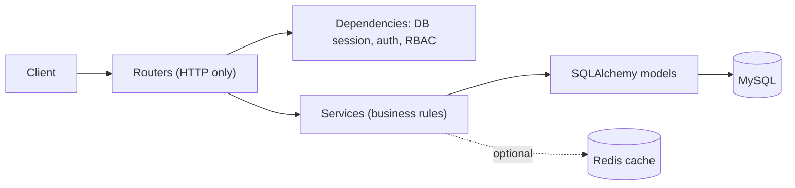

# E-commerce Management API


A backend API for an online store: user accounts with roles, a product catalogue, and orders that
never oversell stock. Built with FastAPI and MySQL.

## Features

- Register / login with JWT; passwords hashed with bcrypt
- Role-based access control (customer vs admin); role is read from the database on every request
- Categories and products with search, price filters, sorting and pagination
- Soft delete for products (history stays intact)
- Orders placed in a single transaction with row locking, so stock can never go negative
- Order cancellation that returns stock
- Audit log of order and product changes (admin only)
- Rate limiting (slowapi) and optional Redis caching of product lists
- Alembic migrations, pytest suite, Docker Compose, GitHub Actions CI

## Tech stack

FastAPI, Pydantic, SQLAlchemy 2.x, Alembic, MySQL 8, Redis (optional), PyJWT, bcrypt, slowapi,
pytest, ruff, Docker, GitHub Actions, Locust.

## Architecture



Routers only handle HTTP. Services hold the rules (stock checks, locking, audit logging).
Pydantic schemas are the API contract; SQLAlchemy models are the database shape. They are kept separate.

## Quick start

```bash
git clone https://github.com/Tushar2674/ecommerce-api.git
cd ecommerce-api
cp .env.example .env        # then edit the values
docker compose up -d --build
docker compose exec api alembic upgrade head
```

Open http://localhost:8000/docs for the interactive API docs.
<!-- VERIFY on a fresh clone before publishing: every command above must work exactly as written. -->

## Design decisions

- **Money is DECIMAL, never float.** Floats cannot represent most decimal prices exactly.
- **`unit_price` is copied into each order line.** Changing a product's price later must not rewrite past orders.
- **Orders lock product rows with `SELECT ... FOR UPDATE`**, always in ascending product id. Locking in a fixed order prevents deadlocks between two orders that share products.
- **The audit log is written in the same transaction as the change.** Either both happen or neither does.
- **Soft delete** keeps old orders pointing at real products.
- **Pagination uses a stable tiebreaker** (id) so rows do not repeat or vanish between pages.
- **Redis is optional.** Cache keys include a version number that is bumped on every product or stock change; if Redis is down the API just queries MySQL.
- **401 vs 403:** 401 means "who are you?", 403 means "you are known but not allowed".

## Testing

```bash
pytest
```

Tests run against a separate `ecommerce_test` database. Highlights: auth and RBAC checks, and a
concurrency test where many threads buy the last units at the same time and stock never goes below zero.
CI runs ruff and pytest on every push against a MySQL service container.

## Load test results

Locust, single uvicorn process on a laptop, MySQL in Docker, rate limiting disabled for the test.
Numbers are from one run each, so treat them as indicative.

**Order placement** (50 users, all buying the same product, so every order queues on one row lock):

| Requests | Failures | Throughput | Median | p95 | p99 |
|---|---|---|---|---|---|
| 1,372 | 0 | 23 orders/s | 410 ms | 1,300 ms | 2,100 ms |

**Consistency:** after the run, the product's stock had dropped by exactly 1,387, and `order_items`
for that product contained 1,387 lines totalling 1,387 units. No lost updates, no overselling.

**Password hashing:** with 20 users signing up at once, register had a median of 1.2 s and login 0.67 s.
That is bcrypt's deliberate cost. Login is also rate limited to 5 per minute.

**Product list caching:** at 50 users (~125 requests/s, capped by the test's own think time) median latency was
61 ms without Redis and 63 ms with it. No measurable benefit at this load, so the cache is kept optional.

## Limitations and next steps

- One process and one database; no horizontal scaling tested
- Hot-product orders serialise on a row lock (the price of correctness)
- Cache benefit not demonstrated at higher load
- No payment or email integration
